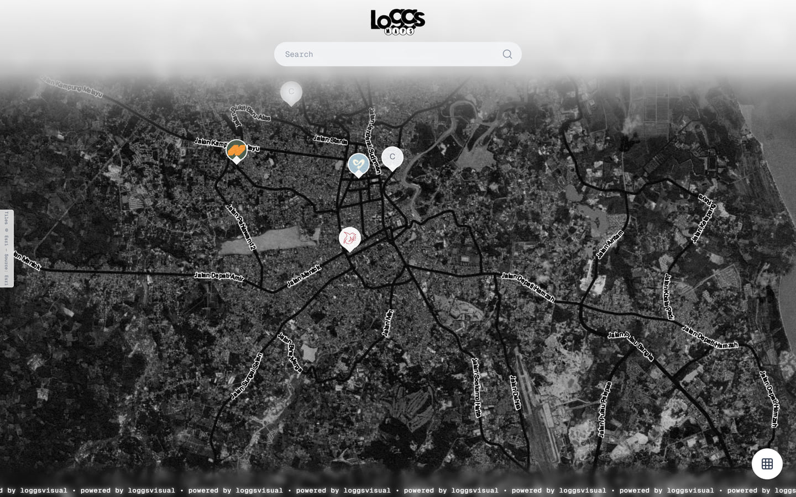
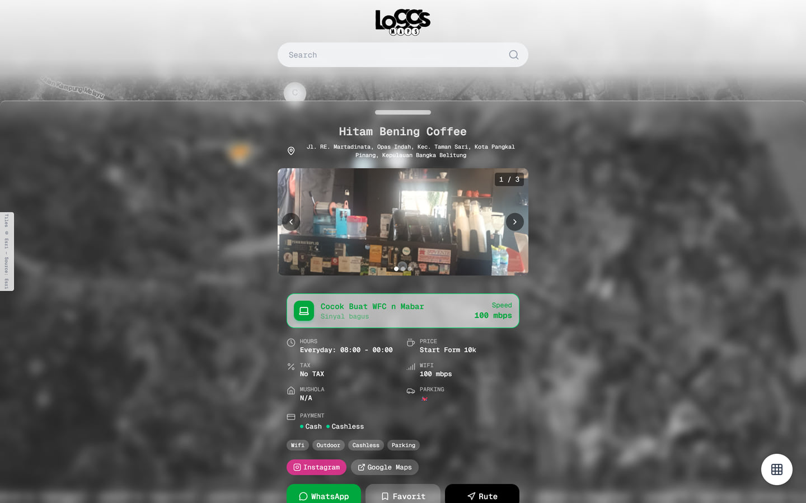
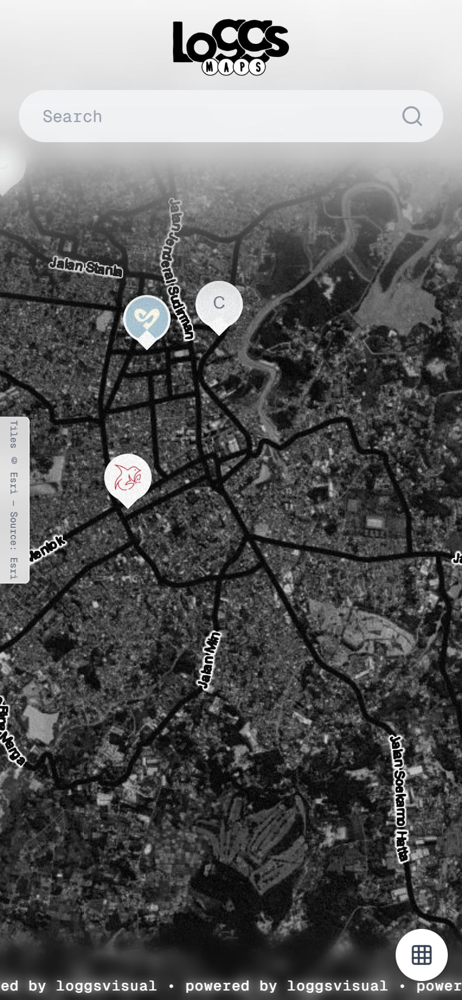

<p align="center">
  
</p>

<h1 align="center">Loggs Maps - Coffee Shop Map for Pangkalpinang</h1>

Loggs Maps is an interactive map of coffee shops in Pangkalpinang. Search for a place, check its hours and facilities, save favorites, and get driving directions. The map runs on Next.js with PostgreSQL. Shop owners manage listings from a password-protected dashboard.

<p align="center">
  <a href="https://maps.loggsvisual.com">
    
  </a>
  
  
  
  
  
  
  <a href="https://github.com/Giandri/Loggs-Map">
    
  </a>
</p>



## Key Capabilities

- **Map-first discovery** - Satellite and street tiles, clustered markers, and search by shop name or address.
- **Nearby and routing** - Use the browser location, see the five closest shops, and get a driving route with distance and duration.
- **Shop profiles** - Photos, opening hours, price range, service tax, Wi-Fi speed, WFC, mushola, parking, payment methods, facilities, and social links.
- **Favorites with consent** - Favorites live in PostgreSQL per session. When cookies are rejected, they fall back to localStorage.
- **Admin dashboard** - Password login, CRUD for shops, logo and photo uploads to Vercel Blob, and a file manager.
- **Live updates** - The map polls the API every 30 seconds, so new listings appear without a reload.

For the full feature set, open the [live demo](https://maps.loggsvisual.com).

## Screenshots

<p align="center">
  
</p>

<p align="center">
  
</p>

## Tech Stack

<p align="center">
  <a href="https://skillicons.dev">
    
  </a>
</p>

## Quick Start

```bash
git clone https://github.com/Giandri/Loggs-Map.git
cd Loggs-Map
npm install
npm run db:push
npm run dev
```

Create a `.env` file with `DATABASE_URL`, `DIRECT_URL`, `BLOB_READ_WRITE_TOKEN`, and `ADMIN_PASSWORD` before running `db:push`. Open [http://localhost:3000](http://localhost:3000), then use the dashboard at [http://localhost:3000/dashboard](http://localhost:3000/dashboard).

## Resources

- [Live Demo](https://maps.loggsvisual.com)
- [GitHub Repository](https://github.com/Giandri/Loggs-Map)
- [Issue Tracker](https://github.com/Giandri/Loggs-Map/issues)


## Deployment

The live application runs at [maps.loggsvisual.com](https://maps.loggsvisual.com).

The API routes use the Node.js runtime because Prisma requires it. No Edge runtime is configured.

## Notes

- Authentication is one shared password, not a multi-user account system.
- The filter control on the map is a placeholder and currently shows a "coming soon" message.
- Data changes appear through 30-second polling, not WebSockets.
- `prisma/seed.ts` predates the current schema. Add data from the dashboard or use Prisma Studio.

## Support

Open an issue at [github.com/Giandri/Loggs-Map/issues](https://github.com/Giandri/Loggs-Map/issues).

## Contributing

Issues and pull requests are welcome. Describe the change and include screenshots for UI updates.

## Credits

Built by [Giandri](https://github.com/Giandri) for Loggs Visual.

Map tiles by Esri and OpenStreetMap. Geocoding by Nominatim. Routing by OSRM. Icons by Lucide.
